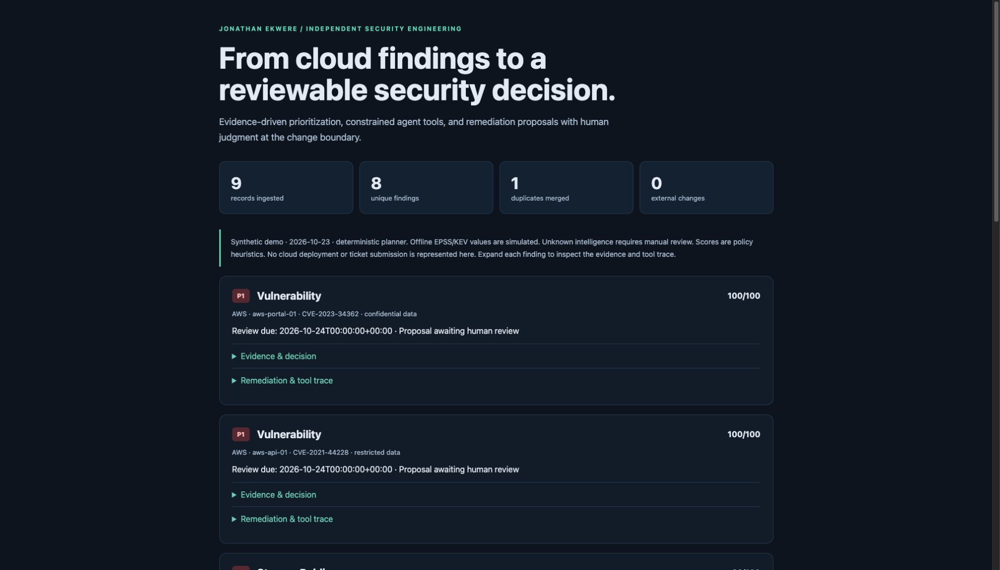

# AI-Powered Cloud Security Triage Agent

[](https://github.com/jayekwere/ai-cloud-security-triage-agent/actions/workflows/ci.yml)


A Python workflow that prioritizes synthetic cloud findings, prepares remediation proposals, and requires review before a ticket can be submitted.

An independent project by **Jonathan Ekwere**, built with AI assistance. The default demo uses synthetic findings and runs without an external scanner or cloud account.



## Example output

- [Sample review brief](examples/demo/report.md) · [Machine-readable results](examples/demo/report.json) · [Tool audit](examples/demo/audit.jsonl)
- [Five-minute demo walkthrough](docs/DEMO.md)
- [Architecture and decisions](docs/ARCHITECTURE.md) · [Threat model](docs/THREAT_MODEL.md)
- [Verification record and limits](docs/VALIDATION.md) · [Capabilities and boundaries](docs/CAPABILITIES.md)

The included demo ingests **9 synthetic records**, merges **1 duplicate**, triages **8 findings**, and emits **51 hash-linked audit events**. These are reproducible fixture counts, not production impact metrics. It performs **zero external writes**.

## Run the offline demo

Requires Python 3.11 or newer. The offline demo needs no runtime packages, cloud account, paid API, Terraform installation or container engine.

```bash
git clone https://github.com/jayekwere/ai-cloud-security-triage-agent.git
cd ai-cloud-security-triage-agent
python3 -m venv .venv
source .venv/bin/activate
python -m pip install -e .
cloudtriage demo --out out/demo
cloudtriage verify-audit out/demo/audit.jsonl
```

Open `out/demo/report.html` in a browser. It is a self-contained local report with expandable evidence, remediation steps and tool traces; it sends no requests. Choose a **new output directory** for each run. Without installing the package, the offline demo also runs as:

```bash
PYTHONPATH=src python3 -m cloudtriage.cli demo --out out/another-demo
```

## Workflow

```mermaid
flowchart LR
    A[Synthetic Wiz/Qualys-style JSON] --> B[Validate and conservatively deduplicate]
    B --> C[Simulated intel or optional public EPSS/KEV reads]
    C --> D[Versioned Python risk policy]
    D --> E[Bounded agent tool loop]
    E --> F[Trusted remediation templates and validation]
    F --> G[HTML / JSON / Markdown + audit chain]
    G --> H[Jira intent preview]
    H --> I[Human reviews exact destination and payload digest]
    I --> J[One optional Jira API attempt]
```



| Capability | Implementation and boundary |
|---|---|
| Cloud context | AWS and Azure synthetic workload, storage, entitlement and network findings; classification, exposure and criticality |
| Vulnerability management | CVSS, EPSS, KEV, stale/missing evidence flags, priority overrides and proposed review SLAs |
| Agentic AI | Optional OpenAI Responses planner selects allowlisted analytical tools; bounded rounds and output tokens; tools return evidence for the next turn |
| Secret-free demo | A deterministic scripted planner exercises the same dispatcher and validators; it is **not an LLM** |
| Advanced Python | Frozen typed models, protocols, async feed enrichment with bounded concurrency, explicit error boundaries, canonical hashes and transactional SQLite approvals |
| Remediation | AWS S3 / Azure Storage Terraform JSON proposals; reviewed runbooks for CVEs, IAM and network changes; no guessed patch versions |
| Human control | No cloud-write or shell tool exists. Jira submit is a separate CLI operation requiring interactive approval, exact digest match, expiry and atomic replay protection |
| API integration | Optional fixed-endpoint FIRST EPSS, CISA KEV, OpenAI Responses and Jira Cloud REST v3; timeouts, byte limits, no redirects |
| Audit and AppSec | Allowlisted audit fields, hash verification, escaped HTML, adversarial tests, Ruff security rules and CI |

## Execution modes

**Offline mode is the default.** Fixtures explicitly label EPSS values and KEV flags as simulated. Public CVE identifiers are scenario labels; `CVE-2099-9999999` is deliberately fictional and missing from the intelligence fixture. The source export contains a prompt-injection string to demonstrate that raw scanner descriptions never enter the model or reports.

**Optional model mode** requires a separately provisioned API key and a model ID your account can access. The implemented model provider is OpenAI. It needs its own API credentials; the project does not reuse credentials or subscriptions from other applications.

```bash
# Set OPENAI_API_KEY and OPENAI_MODEL securely in your local environment first.
cloudtriage triage --provider openai --allow-model-egress \
  --as-of 2026-10-23 --out out/model-review
```

Only minimized, schema-controlled synthetic fields and derived tool results are sent. Raw descriptions, asset aliases, scanner metadata, environment variables and secrets are excluded. `store=false` requests API non-storage; it is **not** a zero-retention or residency guarantee. See [data boundaries](docs/ARCHITECTURE.md#data-and-egress). A model can fail or pick an invalid sequence; the run then fails closed. Free-form model text is not used as authoritative evidence. At most ten findings, eight planner rounds per finding and 800 output tokens per request are allowed.

To read public intelligence instead of fixtures:

```bash
cloudtriage triage --intel live --out out/live-intel
```

Live mode uses today's local date unless `--as-of` is specified, records the source dates, and stops on feed failure instead of silently substituting fixtures. A stale or missing feed result cannot imply low risk. Network availability and feed limits remain external dependencies.

## Risk policy

The model cannot choose a score, lower a priority, invent a fixed package version, modify a Terraform template, approve an action, or send a ticket. The versioned [policy](src/cloudtriage/data/policy.toml) governs decisions. See the complete [scoring rationale and tradeoffs](docs/ARCHITECTURE.md#risk-policy).

The demo deliberately contrasts an internet-facing KEV scenario with a high-CVSS internal scenario. It also places a P2 floor on missing intelligence and escalates exposed sensitive storage to P1. Due dates are **proposed review targets**, calculated from the evaluation date at midnight UTC, not regulatory deadlines or measured remediation outcomes.

## Jira: preview, review, then one approved attempt

The demo writes `jira-dry-run.json` and never contacts Jira. For a real test tenant, use the [runbook](docs/RUNBOOK.md) to generate a single intent, inspect the complete target/payload, approve its digest interactively, and explicitly submit. No Jira credentials are needed for previews or tests.

The local ledger expires approvals after one hour and consumes an intent before the network request. Timeouts become **unknown**, not a retry: an operator must reconcile the tenant to avoid duplicate issues. Reviewer identity is self-asserted on one trusted workstation; this is not enterprise SSO, separation of duties, or a tamper-proof approval service.

Terraform is always a **proposal artifact**. Static validation checks trusted structure and unsafe constructs. The project never runs `terraform apply`, never accesses cloud state, and does not claim provider validation, a successful plan, deployment, or verified remediation.

## Development and CI

```bash
python -m pip install -e '.[dev]'
ruff check .
ruff format --check .
pytest --cov=cloudtriage --cov-report=term-missing
bandit -r src -q
```

GitHub Actions runs linting, security checks, tests, offline demo generation, audit verification and byte-for-byte comparison against committed samples on Python 3.11–3.14. The workflow uses SHA-pinned actions, read-only repository permissions, no live API credentials and a job timeout. Dependabot proposes dependency/action updates. The runtime dependency list is empty; direct development dependencies are pinned, but transitive development dependencies are not a full hash-locked supply chain.

## Scope, authorship and next steps

This is a synthetic-data lab. It does not establish production performance, measured risk reduction or compliance certification. AI assistance was used for code and documentation; tests, sample outputs and limitations are available for review.

Before production use: replace synthetic adapters with authenticated read-only vendor integrations; validate findings against asset inventory and actual configurations; calibrate risk thresholds with owners; obtain privacy/residency approval for model egress; add central identity, signed approvals and durable remote audit storage; validate Terraform with pinned providers and real plans in a sandbox; perform operational, privacy, dependency and load reviews. A real provider call and real Jira write are optional and are not implied by mocked contract tests.

Related portfolio work: [CVE exploit prediction](https://github.com/jayekwere/cve-exploit-prediction), [agent anomaly detection](https://github.com/jayekwere/agent-anomaly-detection), and [secure AWS platform](https://github.com/jayekwere/secure-aws-platform). Those repositories are separate projects; this implementation does not change or claim to complete them.

## References

- [OpenAI function calling](https://developers.openai.com/api/docs/guides/function-calling) for the Responses tool-call/output loop.
- [FIRST EPSS](https://www.first.org/epss/) and [public API](https://api.first.org/data/v1/epss) for exploitation-likelihood enrichment.
- [CISA KEV catalog](https://www.cisa.gov/known-exploited-vulnerabilities-catalog) and [JSON feed](https://www.cisa.gov/sites/default/files/feeds/known_exploited_vulnerabilities.json).
- [Jira Cloud issue creation](https://developer.atlassian.com/cloud/jira/platform/rest/v3/api-group-issues/#api-rest-api-3-issue-post).

MIT licensed. See [SECURITY.md](SECURITY.md) for the security boundary and reporting guidance.
